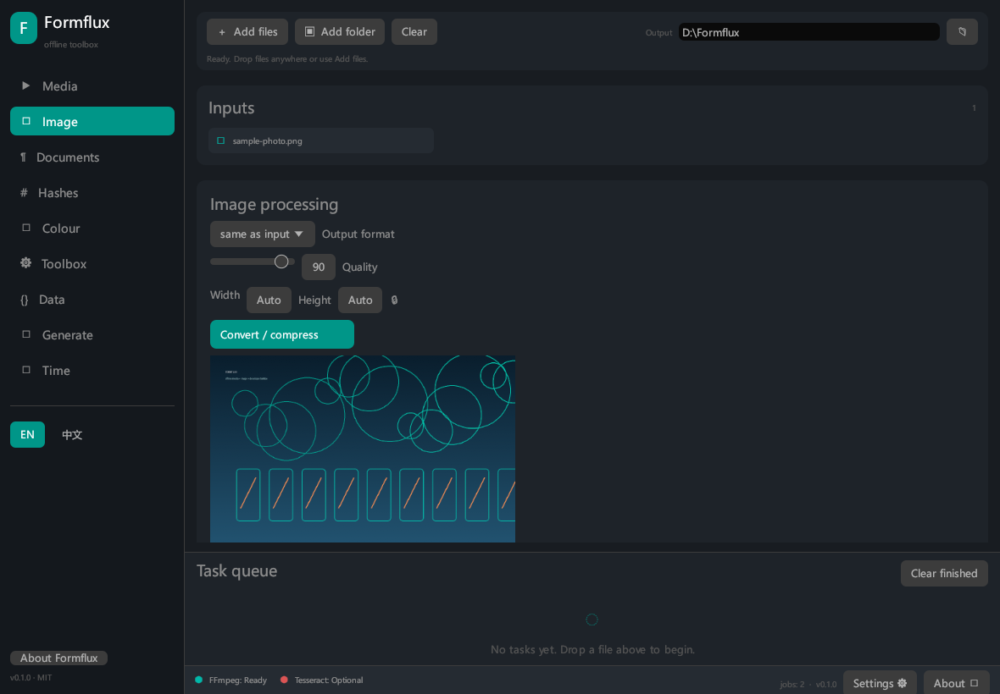
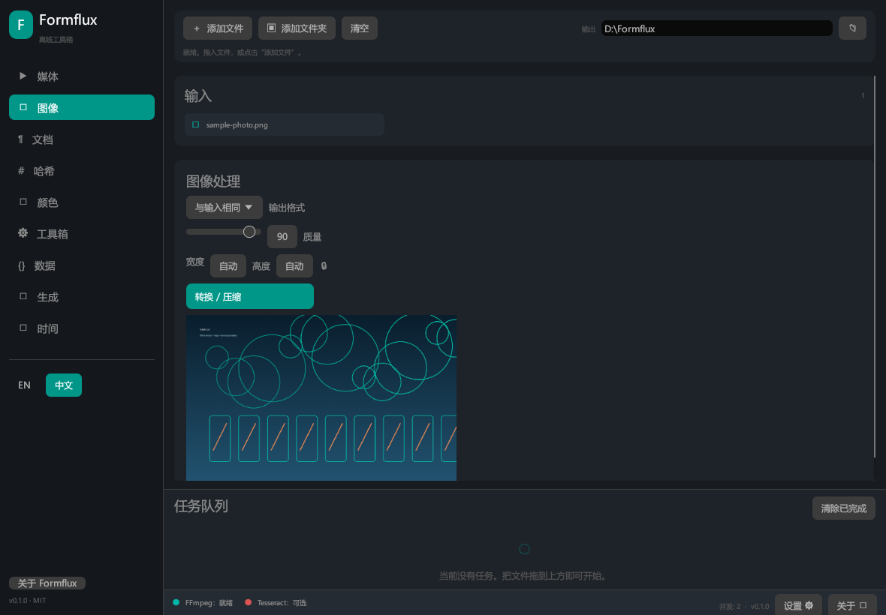
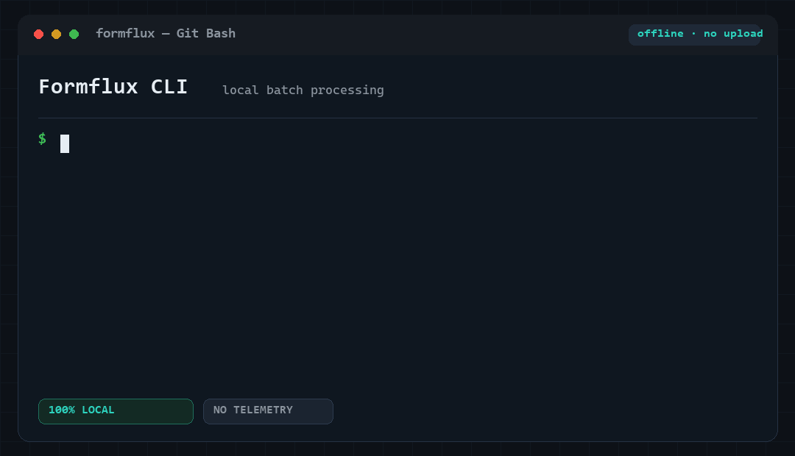

# Formflux

**本地、离线、无水印的一站式文件工具箱。**
**A local, offline toolbox for media, images, documents, hashes, colours, data and time.**

[简体中文](#简体中文) · [English](#english)

`MIT` · `Rust 1.85+` · `Windows / Linux / macOS` · `0 network calls`

Formflux 把在线转换器能做的事搬回本机：拖入文件、转换、压缩、校验、提取，
全程不联网、不上传、不加水印。没有账户，没有额度，没有遥测。
Formflux brings everyday file processing back to your machine: convert,
compress, inspect, hash and generate — with no upload, no account, no quota,
no watermark and no telemetry.



<p align="center"><em>Formflux GUI · English</em></p>



<p align="center"><em>Formflux 图形界面 · 简体中文</em></p>

## 命令行演示 · CLI demo



<p align="center"><em>图片转换、SHA-256 校验、二维码生成 —— 全程本地完成。</em></p>

---

## 简体中文

### 为什么是 Formflux

- **隐私优先**：源代码和依赖树中没有任何 HTTP 客户端，`cargo-deny` 与
  `scripts/check-offline.sh` 双重拦截网络库和网络调用。
- **没有隐藏成本**：不限制文件大小、不压缩画质换会员、不添加水印。
- **一个工具覆盖日常**：媒体、图像、文档、哈希、颜色、数据、生成、时间。
- **脚本友好**：同一套 `core` 同时驱动 CLI 与 GUI；`--json` 输出稳定。
- **可控的性能**：Tokio + Rayon；并发数、内存预算均可配置。

### 下载与安装

从 [Releases](https://github.com/dieraun/Formflux/releases/latest) 下载最新版本。

- **Windows**：解压 `Formflux-0.1.0-windows-x64.zip`，直接运行
  `formflux.exe`（CLI）或 `formflux-gui.exe`（桌面界面）。无需安装。
- **从源码构建**：

  ```sh
  git clone https://github.com/dieraun/Formflux.git
  cd Formflux
  cargo build --release -p formflux-cli -p formflux-gui
  ```

  产物位于 `target/release/`。

- **Linux / macOS**：使用源码构建；Linux CLI 支持 musl 静态分发，
  详见 [构建](#构建与分发)。macOS 与 Linux 的图形界面需要系统图形库。

### 五分钟上手

```sh
# 1. 检查外部工具（FFmpeg / Tesseract / CUDA）
formflux doctor

# 2. 视频转 MP4（H.264 + AAC），或无损流复制
formflux media convert movie.mkv --format mp4 --crf 20
formflux media convert movie.mkv --format mp4 --stream-copy

# 3. 视频导出 GIF / WebP 动图
formflux media convert clip.mov --format gif --gif-fps 12
formflux media convert clip.mov --format webp --width 960

# 4. 图片批量转 WebP、改尺寸、去 EXIF
formflux image convert photos/ --format webp --quality 82 --output out/
formflux image compress *.png --width 1600 --output compressed/
formflux image exif photo.jpg --strip --output clean/

# 5. 哈希、清单与验真
formflux hash file release/ --algorithm sha256 --manifest SHA256SUMS
formflux hash verify SHA256SUMS --base .

# 6. 文本编码、格式化与数据转换
formflux text transcode legacy.txt --from gbk --to utf8 --output notes.txt
formflux data convert config.json --to yaml --pretty
formflux text radix 0xff 0b1010 777 --to 16

# 7. 颜色、时间、生成
formflux color convert "#ff8800" --to hsl
formflux time now --tz Europe/Berlin
formflux gen qr "https://github.com/dieraun/Formflux" --output repo.png
```

所有命令都支持 `--json`、`--quiet`、`--dry-run`、`--force`、`-j/--jobs`。
输出默认写入新文件，源文件永不修改；目标已存在时拒绝覆盖，除非显式 `--force`。

### 图形界面

- 拖拽文件或文件夹到窗口即可加入队列。
- 左侧按任务域切换：媒体、图像、文档、哈希、颜色、工具箱、数据、生成、时间。
- 主操作使用强调色；任务队列显示进度、速度和状态，可取消、清理。
- 输出目录支持浏览选择；长路径中间省略，保留文件名。
- 宽高留空显示 `Auto`，可锁定比例，只填一边即可等比缩放。
- 底部状态栏实时显示 FFmpeg / Tesseract 可用性；设置中可调整并发数。
- 界面支持 English / 简体中文，可在左下角切换；About 中显示作者与仓库。

### 功能总览

| 模块 | 能力 |
| --- | --- |
| 媒体 | MP4 / WEBM / MKV / AVI / MOV / FLV / TS / WMV；GIF / WebP 动图；流复制或重编码；CRF、码率、FPS、分辨率、裁剪、旋转、HDR→SDR；字幕封装/提取（SRT / ASS）；音频 MP3 / FLAC / WAV / OGG / AAC / M4A / ALAC / APE / WMA；响度标准化、降噪、截取、采样率/声道 |
| 图像 | JPG / PNG / WebP / BMP / TIFF / ICO / GIF；批量转换与压缩；EXIF 读取/清除；缩放、裁剪、旋转、翻转；亮度/对比度/饱和度/伽马；文字或图片水印 |
| 文档与文本 | Markdown / HTML / TXT 互转；CSV / TSV；Base64 / Base32 / URL / Unicode；GBK / UTF-8 转码；Diff；正则替换；空白清洗；大小写风格；外部 Tesseract OCR |
| 哈希 | MD5 / SHA-1 / SHA-256 / SHA-384 / SHA-512 / BLAKE2b；单文件与目录；清单生成与批量验真 |
| 颜色 | HEX / RGB / RGBA / HSL / HSLA / CMYK / LAB；WCAG 对比度；渐变；GPL / JSON 调色板 |
| 文件工具箱 | 批量重命名（序号/前缀/后缀/正则/EXIF 时间）；哈希去重；分割/合并；空目录清理；元信息；单位换算 |
| 数据 | JSON / YAML / XML 美化、压缩、校验、互转；字段提取 |
| 生成 | 二维码、EAN-13 条形码、UUID v4/v7、随机密码、密码强度 |
| 时间 | 秒/毫秒/微秒时间戳；UTC / 本地 / IANA 时区；格式化与互转 |

### 构建与分发

```sh
cargo build --release
cargo test --workspace
cargo clippy --workspace --all-targets -- -D warnings
cargo fmt --all -- --check
```

工作区产出两个二进制：`formflux`（CLI）与 `formflux-gui`（桌面界面）。

| Feature | 作用 | 说明 |
| --- | --- | --- |
| 默认 | `formflux-min`：JPEG/PNG/WebP/BMP/TIFF/ICO/GIF | 可静态链接 |
| `avif` | 通过 `image` 编解码 AVIF | 引入 C/汇编编解码代码 |
| `heic` | 预留 libheif 集成 | 当前返回 `Unsupported` |
| `raw` | 预留 rawloader 集成 | 当前返回 `Unsupported` |
| `cuda` | NVIDIA 设备检测与 CPU 回退 | 当前仅检测，加速内核为路线图 |

```sh
cargo build --release --features avif
cargo build --release --features cuda
```

带 `avif` / `heic` / `raw` / `cuda` 的构建命名为 `formflux-full`，不属于严格单文件。

**Linux 静态 CLI**（musl，不依赖 glibc）：

```sh
RUSTFLAGS="-C target-feature=+crt-static" \
  cargo build --release --target x86_64-unknown-linux-musl -p formflux-cli
```

**Windows**：`x86_64-pc-windows-msvc` + 静态 CRT。GUI 使用 Windows 子系统，
不弹出控制台窗口。

**macOS**：分别构建 `aarch64-apple-darwin` 与 `x86_64-apple-darwin`；CI 生成
可执行文件，`.app` 打包可按需扩展。

### 外部运行时依赖

Formflux 不捆绑、不链接 FFmpeg 或 Tesseract。启动时探测 `PATH` 与配置路径；
缺失时相关功能禁用并给出提示，其余功能不受影响。

| 工具 | 用途 | 配置项 |
| --- | --- | --- |
| FFmpeg + ffprobe | 媒体转换、探测、缩略图、字幕 | `[tools] ffmpeg_path`、`ffprobe_path` |
| Tesseract | 离线 OCR | `[tools] tesseract_path`、`ocr_lang` |

`formflux doctor` 会报告路径、版本与警告。FFmpeg 通过子进程调用，不链接
`ffmpeg-sys`；其许可证（LGPL/GPL，取决于构建）与本项目无关。Tesseract 为
Apache-2.0。

### 配置文件

首次启动自动创建，也可用 `--config <path>` 或 `FORMFLUX_CONFIG` 覆盖。

- Windows：`%APPDATA%\formflux\formflux\config.toml`
- Linux：`~/.config/formflux/config.toml`
- macOS：`~/Library/Application Support/io.formflux.formflux/config.toml`

```toml
version = 1
log_level = "info"

[tools]
ffmpeg_path = "C:/tools/ffmpeg/bin/ffmpeg.exe"
ffprobe_path = "C:/tools/ffmpeg/bin/ffprobe.exe"
tesseract_path = "C:/Program Files/Tesseract-OCR/tesseract.exe"
ocr_lang = "eng"
cuda = false

[runtime]
jobs = 0              # 0 = 逻辑 CPU 数
memory_budget_mb = 512
overwrite = false
keep_temp = false
progress_step = 1

[ui]
theme = "system"      # system | dark | light
language = "en"       # en | zh
scale = 1.0
start_maximized = false
```

### 架构

```text
crates/
├── shared/  # 错误、配置、日志、路径安全、原子 IO、内存预算、单位
├── core/    # 全部业务逻辑；不依赖 egui / clap
├── cli/     # clap 命令行前端
├── gui/     # egui 桌面前端
└── cuda/    # 可选 NVIDIA 检测/加速层
```

- `core` 可被任意前端复用，对外 API 统一返回 `Result<T, FormfluxError>`。
- 文件访问集中在 `shared::fs` 与 `core::io`。
- 外部路径经过 `safe_join` 校验，拒绝 `..`、绝对路径逃逸和符号链接逃逸。
- GUI 在 Tokio 多线程运行时执行任务，通过 channel 汇报进度，绘制线程不阻塞。

### 安全与隐私

- **无网络客户端**：`deny.toml` 禁止 `reqwest`、`hyper`、`curl`、`ureq`、
  `rustls`、`native-tls` 等；CI 运行 `scripts/check-offline.sh`。
- **无遥测、无广告、无水印、无云同步**。
- 源文件只读；输出先写临时文件，成功后 `rename`，失败不留半成品。
- 已存在目标默认不覆盖，必须显式 `--force`。
- 清单校验拒绝绝对路径与父目录穿越。
- 大文件与媒体复制使用分块流式 IO，不整文件读入内存。
- 所有新增代码保持 `#![forbid(unsafe_code)]` 的 shared/core 约束。

### 性能

- Tokio 多线程 + Rayon 数据并行；并发上限由 `runtime.jobs` 控制。
- 图像处理按内存预算排队，预算不足时等待而不是 OOM。
- 媒体复制使用 64 KiB 缓冲区；FFmpeg 进度通过 `-progress pipe:1` 实时解析。
- 目标是在 10 GB 级视频转换中，Formflux 自身 RSS 峰值低于 300 MB（不含
  FFmpeg 子进程）。该指标尚未在 10 GB 样本上完成基准测试，见“当前限制”。

### 平台矩阵

| 目标 | CI 构建 | 说明 |
| --- | --- | --- |
| `x86_64-pc-windows-msvc` | `formflux-min`、`formflux-full` | 静态 CRT，GUI 为 Windows 子系统 |
| `x86_64-unknown-linux-musl` | `formflux-min`、`formflux-full` | CLI 静态 musl；GUI 需系统图形库 |
| `aarch64-apple-darwin` | `formflux-min` | Apple Silicon |
| `x86_64-apple-darwin` | `formflux-min` | Intel macOS |

### 当前限制

这些限制已逐项登记为 GitHub Issues（标签 `enhancement` / `help wanted`）：

1. **HEIC / RAW**：feature 名称与错误提示已就绪，编解码尚未接入，返回
   `Unsupported`。([#1](https://github.com/dieraun/Formflux/issues/1))
2. **CUDA**：仅做设备检测与 CPU 回退；GPU 滤波/缩放内核尚未实现。
   ([#2](https://github.com/dieraun/Formflux/issues/2))
3. **OCR 验证**：OCR 走外部 Tesseract，开发机未安装 Tesseract，因此该路径
   未做端到端实测；安装后即可使用。
   ([#3](https://github.com/dieraun/Formflux/issues/3))
4. **EXIF 写入**：支持读取与清除，未暴露任意标签写入 API。
   ([#4](https://github.com/dieraun/Formflux/issues/4))
5. **屏幕取色**：为避免全局钩子与 unsafe，未实现系统级屏幕取色；GUI 提供
   可编辑色板，CLI 接受任意颜色字符串。
   ([#5](https://github.com/dieraun/Formflux/issues/5))
6. **内存基准**：流式设计已落地，但 10 GB 视频 / 300 MB RSS 指标尚未实测。
   ([#6](https://github.com/dieraun/Formflux/issues/6))
7. **跨平台实测**：v0.1.0 的 Windows 构建与冒烟测试已完成；Linux musl 与
   macOS 由 CI 构建，尚未在本机运行验证。
   ([#7](https://github.com/dieraun/Formflux/issues/7))

### 测试与 CI

```sh
cargo test --workspace
cargo clippy --workspace --all-targets -- -D warnings
cargo fmt --all -- --check
sh scripts/check-offline.sh
```

当前测试：105 个 core 单元测试、1 个集成测试、2 个 CUDA 测试、32 个 shared
测试、1 个 CLI 测试，共 141 个，全部通过。

`.github/workflows/release.yml` 在 `v*` 标签上执行格式检查、Clippy、测试、
离线检查、cargo-deny，构建 Windows / Linux musl / macOS 产物并发布 Release。

### 许可证

MIT，见 [LICENSE](LICENSE)。作者：[dieraun](https://github.com/dieraun)。
FFmpeg 与 Tesseract 为外部运行时依赖，遵循各自许可证。

---

## English

### Why Formflux

- **Private by construction**: no HTTP client in the source tree or dependency
  graph. `cargo-deny` and `scripts/check-offline.sh` enforce the rule in CI.
- **No hidden limits**: no file-size paywall, no quality downgrade, no watermark.
- **One toolbox**: media, images, documents, hashes, colour, data, generation
  and time — all local.
- **Scriptable**: one `core` powers both the CLI and the GUI; `--json` output is
  stable.
- **Predictable performance**: Tokio + Rayon, configurable concurrency and a
  global memory budget.

### Download

Get the latest build from
[Releases](https://github.com/dieraun/Formflux/releases/latest).

- **Windows**: unzip `Formflux-0.1.0-windows-x64.zip` and run `formflux.exe`
  (CLI) or `formflux-gui.exe` (desktop). No installer required.
- **Build from source**:

  ```sh
  git clone https://github.com/dieraun/Formflux.git
  cd Formflux
  cargo build --release -p formflux-cli -p formflux-gui
  ```

- **Linux / macOS**: build from source. Linux CLI supports static musl
  distribution; see [Build and distribution](#build-and-distribution). The GUI
  needs the platform graphics libraries.

### Quick start

```sh
# Check external tools
formflux doctor

# Video to MP4 (H.264 + AAC) or lossless stream copy
formflux media convert movie.mkv --format mp4 --crf 20
formflux media convert movie.mkv --format mp4 --stream-copy

# Animated GIF / WebP
formflux media convert clip.mov --format gif --gif-fps 12
formflux media convert clip.mov --format webp --width 960

# Batch images: WebP, resize, strip EXIF
formflux image convert photos/ --format webp --quality 82 --output out/
formflux image compress *.png --width 1600 --output compressed/
formflux image exif photo.jpg --strip --output clean/

# Hashes and manifests
formflux hash file release/ --algorithm sha256 --manifest SHA256SUMS
formflux hash verify SHA256SUMS --base .

# Text encodings and data
formflux text transcode legacy.txt --from gbk --to utf8 --output notes.txt
formflux data convert config.json --to yaml --pretty
formflux text radix 0xff 0b1010 777 --to 16

# Colour, time, generators
formflux color convert "#ff8800" --to hsl
formflux time now --tz Europe/Berlin
formflux gen qr "https://github.com/dieraun/Formflux" --output repo.png
```

Every command supports `--json`, `--quiet`, `--dry-run`, `--force` and
`-j/--jobs`. Outputs are new files; sources are never modified and existing
destinations are not overwritten without `--force`.

### Desktop GUI

- Drag files or folders anywhere into the window.
- Sidebar groups: Media, Image, Documents, Hashes, Colour, Toolbox, Data,
  Generate, Time.
- Accent primary actions, task queue with progress/speed, cancel, clear.
- Output folder picker; long paths are middle-truncated while keeping the name.
- Empty width/height shows `Auto`; lock aspect ratio to scale from one side.
- Status bar shows FFmpeg / Tesseract availability; Settings controls jobs.
- English / 简体中文 switch in the sidebar; About shows author and repository.

### Feature matrix

| Area | Capabilities |
| --- | --- |
| Media | MP4 / WEBM / MKV / AVI / MOV / FLV / TS / WMV; GIF / WebP animation; stream copy or re-encode; CRF, bitrate, FPS, resolution, crop, rotate, HDR→SDR; subtitle mux/extract (SRT / ASS); audio MP3 / FLAC / WAV / OGG / AAC / M4A / ALAC / APE / WMA; loudness normalisation, denoise, trim, sample rate/channels |
| Images | JPG / PNG / WebP / BMP / TIFF / ICO / GIF; batch convert/compress; EXIF read/strip; resize, crop, rotate, flip; brightness/contrast/saturation/gamma; text or image watermark |
| Documents | Markdown / HTML / TXT; CSV / TSV; Base64 / Base32 / URL / Unicode; GBK / UTF-8 transcoding; diff; regex replace; whitespace cleanup; case styles; external Tesseract OCR |
| Hashes | MD5 / SHA-1 / SHA-256 / SHA-384 / SHA-512 / BLAKE2b; files and directories; manifests and verification |
| Colour | HEX / RGB / RGBA / HSL / HSLA / CMYK / LAB; WCAG contrast; gradients; GPL / JSON palettes |
| Toolbox | Batch rename (sequence/prefix/suffix/regex/EXIF time); hash dedupe; split/merge; empty-dir cleanup; metadata; unit conversion |
| Data | JSON / YAML / XML pretty-print, minify, validate, convert; path extraction |
| Generate | QR codes, EAN-13 barcodes, UUID v4/v7, passwords, password strength |
| Time | s/ms/µs timestamps; UTC / local / IANA zones; formatting and conversion |

### Build and distribution

```sh
cargo build --release
cargo test --workspace
cargo clippy --workspace --all-targets -- -D warnings
cargo fmt --all -- --check
```

| Feature | Effect | Notes |
| --- | --- | --- |
| default | `formflux-min`: JPEG/PNG/WebP/BMP/TIFF/ICO/GIF | Static linking possible |
| `avif` | AVIF via the `image` crate | Adds C/assembly codec code |
| `heic` | Reserved for libheif | Returns `Unsupported` today |
| `raw` | Reserved for rawloader | Returns `Unsupported` today |
| `cuda` | NVIDIA detection + CPU fallback | Detection only; kernels are roadmap work |

```sh
cargo build --release --features avif
cargo build --release --features cuda
```

Builds with `avif` / `heic` / `raw` / `cuda` are shipped as `formflux-full` and
are not strict single-file binaries.

**Static Linux CLI**:

```sh
RUSTFLAGS="-C target-feature=+crt-static" \
  cargo build --release --target x86_64-unknown-linux-musl -p formflux-cli
```

**Windows**: `x86_64-pc-windows-msvc` with static CRT; the GUI uses the Windows
subsystem and does not open a console.

**macOS**: build `aarch64-apple-darwin` and `x86_64-apple-darwin` separately;
CI publishes the binaries, `.app` packaging can be added later.

### External runtime dependencies

Formflux never bundles or links FFmpeg/Tesseract. It probes `PATH` and configured
paths at startup; missing tools disable only the related features.

| Tool | Used for | Configuration |
| --- | --- | --- |
| FFmpeg + ffprobe | media conversion, probing, thumbnails, subtitles | `[tools] ffmpeg_path`, `ffprobe_path` |
| Tesseract | offline OCR | `[tools] tesseract_path`, `ocr_lang` |

`formflux doctor` prints paths, versions and warnings. FFmpeg is invoked as a
subprocess (no `ffmpeg-sys`); its license (LGPL/GPL depending on build) is
separate from this project. Tesseract is Apache-2.0.

### Configuration

Created on first run; override with `--config <path>` or `FORMFLUX_CONFIG`.

- Windows: `%APPDATA%\formflux\formflux\config.toml`
- Linux: `~/.config/formflux/config.toml`
- macOS: `~/Library/Application Support/io.formflux.formflux/config.toml`

```toml
version = 1
log_level = "info"

[tools]
ffmpeg_path = "C:/tools/ffmpeg/bin/ffmpeg.exe"
ffprobe_path = "C:/tools/ffmpeg/bin/ffprobe.exe"
tesseract_path = "C:/Program Files/Tesseract-OCR/tesseract.exe"
ocr_lang = "eng"
cuda = false

[runtime]
jobs = 0              # 0 = logical CPU count
memory_budget_mb = 512
overwrite = false
keep_temp = false
progress_step = 1

[ui]
theme = "system"      # system | dark | light
language = "en"       # en | zh
scale = 1.0
start_maximized = false
```

### Architecture

```text
crates/
├── shared/  # errors, config, logging, path safety, atomic IO, memory budget
├── core/    # all functionality; no egui, no clap
├── cli/     # clap front end
├── gui/     # egui front end
└── cuda/    # optional NVIDIA detection / acceleration layer
```

Every public core API returns `Result<T, FormfluxError>`. Filesystem access goes
through `shared::fs` and `core::io`; external paths are validated with
`safe_join`, rejecting `..`, absolute escapes and symlink escapes.
The GUI runs work on a Tokio multi-thread runtime and communicates over a
channel, so the paint thread never blocks.

### Security and privacy

- **No network client**: `deny.toml` bans `reqwest`, `hyper`, `curl`, `ureq`,
  `rustls`, `native-tls` and friends; CI runs `scripts/check-offline.sh`.
- **No telemetry, ads, watermarks or cloud sync.**
- Source files are opened read-only.
- Atomic writes (temporary file + rename) avoid half-written outputs.
- Existing destinations are not overwritten without `--force`.
- Manifest verification rejects absolute and parent-traversal entries.
- Large files and media copies are streamed in chunks, never loaded whole.
- `shared` and `core` keep `#![forbid(unsafe_code)]`.

### Performance

- Tokio multi-thread runtime + Rayon data parallelism; concurrency is bounded by
  `runtime.jobs`.
- Image jobs reserve from a global memory budget and wait rather than OOM.
- Media copies use a 64 KiB buffer; FFmpeg progress is parsed from
  `-progress pipe:1`.
- Target: Formflux RSS below 300 MB while converting a 10 GB video (FFmpeg
  process excluded). This has not yet been benchmarked on a 10 GB sample; see
  Current limits.

### Platform matrix

| Target | CI build | Notes |
| --- | --- | --- |
| `x86_64-pc-windows-msvc` | `formflux-min`, `formflux-full` | static CRT, GUI uses Windows subsystem |
| `x86_64-unknown-linux-musl` | `formflux-min`, `formflux-full` | static musl CLI; GUI needs system graphics libraries |
| `aarch64-apple-darwin` | `formflux-min` | Apple Silicon |
| `x86_64-apple-darwin` | `formflux-min` | Intel macOS |

### Current limits

Tracked as GitHub Issues with `enhancement` / `help wanted` labels:

1. **HEIC / RAW**: feature names and errors exist; codecs are not wired up yet
   and return `Unsupported`.
   ([#1](https://github.com/dieraun/Formflux/issues/1))
2. **CUDA**: device detection and CPU fallback only; GPU filter/resize kernels
   are not implemented.
   ([#2](https://github.com/dieraun/Formflux/issues/2))
3. **OCR validation**: OCR uses external Tesseract. The development machine did
   not have Tesseract installed, so this path is not end-to-end tested yet.
   ([#3](https://github.com/dieraun/Formflux/issues/3))
4. **EXIF writing**: reading and stripping are supported; arbitrary tag writing
   is not exposed.
   ([#4](https://github.com/dieraun/Formflux/issues/4))
5. **Screen colour picker**: avoided unsafe global hooks; the GUI offers an
   editable swatch and the CLI accepts any colour string.
   ([#5](https://github.com/dieraun/Formflux/issues/5))
6. **Memory benchmark**: streaming is implemented, but the 10 GB / 300 MB RSS
   target has not been measured.
   ([#6](https://github.com/dieraun/Formflux/issues/6))
7. **Cross-platform validation**: v0.1.0 was built and smoke-tested on Windows;
   Linux musl and macOS are built by CI but were not run locally.
   ([#7](https://github.com/dieraun/Formflux/issues/7))

### Tests and CI

```sh
cargo test --workspace
cargo clippy --workspace --all-targets -- -D warnings
cargo fmt --all -- --check
sh scripts/check-offline.sh
```

Current suite: 105 core unit tests, 1 integration test, 2 CUDA tests, 32 shared
tests and 1 CLI test — 141 passing.

`.github/workflows/release.yml` runs fmt, clippy, tests, the offline check and
cargo-deny, builds Windows / Linux musl / macOS artifacts, and publishes a
GitHub Release on `v*` tags.

### License

MIT. See [LICENSE](LICENSE). Author: [dieraun](https://github.com/dieraun).
FFmpeg and Tesseract are external runtime dependencies under their own licenses.

---

**Formflux — your files stay yours.**
**Formflux —— 文件留在你手里。**
